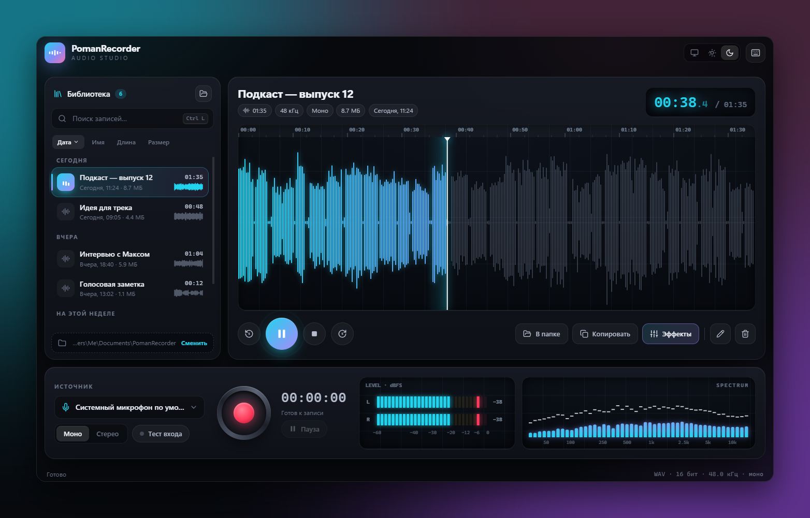
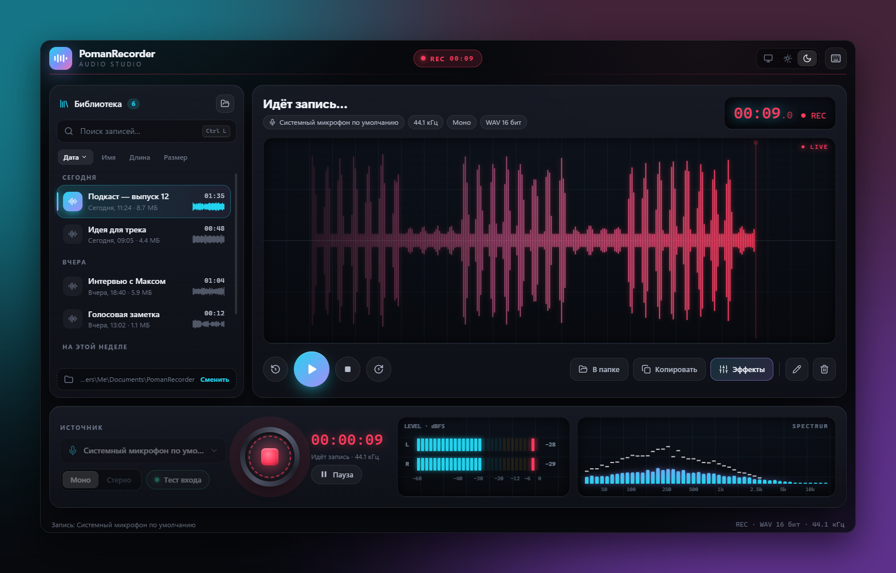
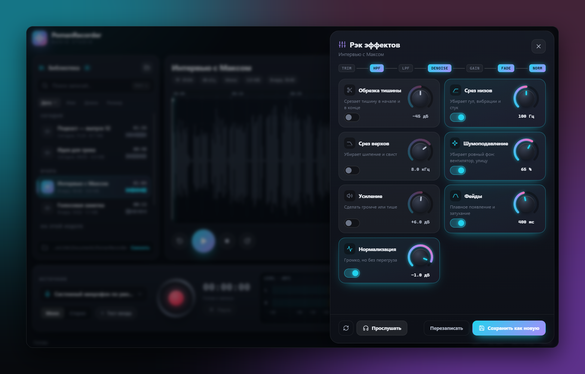
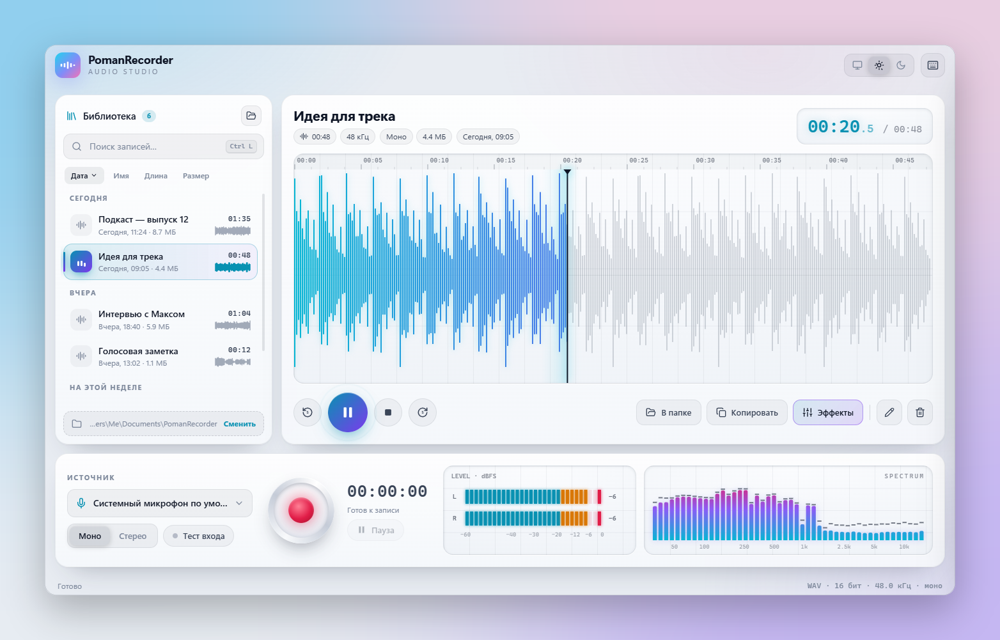

  

<h1 align="center">PomanRecorder</h1>

  Рекордер звука для Windows в стиле студийного пульта: 
  запись с любого микрофона, библиотека записей, спектроанализатор и рэк эффектов.

  <a href="https://github.com/legafise/Recorder/raw/main/%D0%A3%D1%81%D1%82%D0%B0%D0%BD%D0%BE%D0%B2%D1%89%D0%B8%D0%BA/PomanRecorder-Setup-1.0.exe"><b>⬇ Скачать установщик для Windows</b></a>
  &nbsp;·&nbsp;
  <a href="ИНСТРУКЦИЯ.md">Инструкция</a>

<picture>
  <source media="(prefers-color-scheme: dark)" srcset="docs/hero-dark.png">
  <source media="(prefers-color-scheme: light)" srcset="docs/hero-light.png">
  
</picture>

## Возможности

- **Запись** с выбранного микрофона, моно или стерео, с паузой и проверкой уровня входа.
- **Индикаторы как на пульте:** LED-индикатор уровня L/R с пиками, спектроанализатор на 48 полос, живая волна во время записи.
- **Библиотека:** поиск, сортировка, группировка по дням, мини-волна у каждой записи.
- **Работа с файлом:** показать в Проводнике, скопировать сам файл в буфер обмена (вставляется в мессенджер или папку через Ctrl+V), переименовать, удалить в Корзину.
- **Рэк эффектов** с вращающимися ручками: обрезка тишины, срез низов и верхов, шумоподавление, усиление, фейды, нормализация, с предпрослушиванием.
- **Тёмная и светлая темы:** по умолчанию как в Windows.
- **Горячие клавиши** на всё основное: Ctrl+R для записи, пробел для воспроизведения и другие.

<table>
  <tr>
    <td width="50%"></td>
    <td width="50%"></td>
  </tr>
  <tr>
    <td align="center"><b>Запись</b>: живая волна, уровни и спектр</td>
    <td align="center"><b>Рэк эффектов</b>: ручки крутятся как настоящие</td>
  </tr>
  <tr>
    <td width="50%"></td>
    <td width="50%"></td>
  </tr>
  <tr>
    <td align="center"><b>Тёмная тема</b></td>
    <td align="center"><b>Светлая тема</b></td>
  </tr>
</table>

## Установка

1. Скачайте [`PomanRecorder-Setup-1.0.exe`](https://github.com/legafise/Recorder/raw/main/%D0%A3%D1%81%D1%82%D0%B0%D0%BD%D0%BE%D0%B2%D1%89%D0%B8%D0%BA/PomanRecorder-Setup-1.0.exe) (≈37 МБ) и запустите.
2. Нажмите «Далее» → «Далее». Права администратора не нужны.
3. Готово: ярлык появится на рабочем столе и в меню «Пуск».

Записи сохраняются в «Документы\PomanRecorder». Нужна Windows 10 или 11 (64-бит).

> Установщик не подписан платной цифровой подписью, поэтому Windows может показать «Windows защитила ваш компьютер».
> Нажмите «Подробнее» → «Выполнить в любом случае».

## Из исходников

| Файл | Что внутри |
|---|---|
| `recorder.py` | окно (pywebview) и связь интерфейса со звуком |
| `audio_core.py` | запись, воспроизведение, эффекты, анализ (sounddevice, numpy, scipy) |
| `ui/` | интерфейс на HTML, CSS и JavaScript |
| `Запуск.bat` | запуск из исходников (нужен Python 3.10+) |
| `build/build.bat` | сборка `PomanRecorder.exe` (PyInstaller) и установщика (Inno Setup: `winget install JRSoftware.InnoSetup`) |
